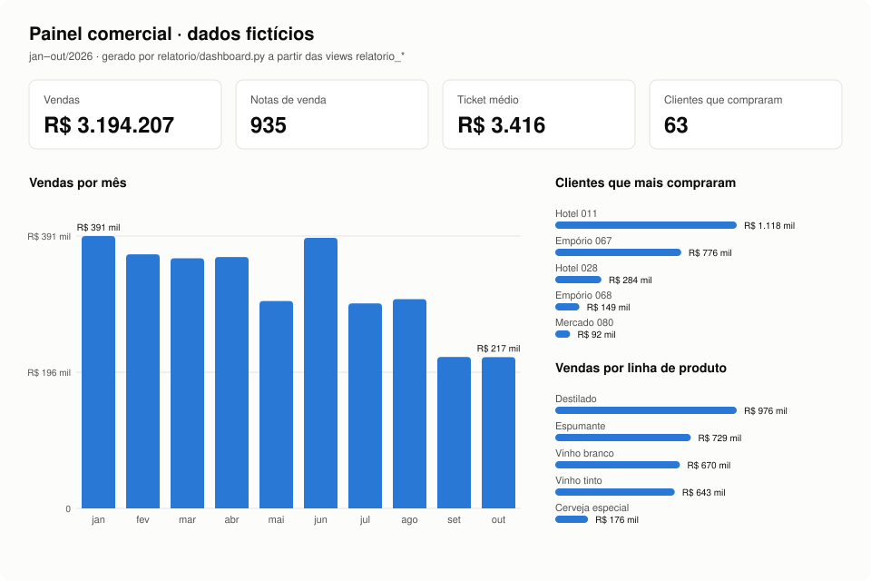

# Dados com IA

**BI de ponta a ponta construído com IA: do ERP ao Power BI, com carga automática, banco em camadas e automações de negócio.**

Sou Giovanna, analista de dados júnior e estudante de Banco de Dados. Este repositório é uma **versão de demonstração** de um projeto que construí e mantenho em produção numa distribuidora de bebidas. A arquitetura, as regras e a lógica são as mesmas; o código foi reescrito do zero e **todos os dados são fictícios**.

---

## O problema

Vendas, compras e estoque ficavam só dentro do ERP. Os relatórios eram montados à mão em Excel, e o envio mensal de sell-out para a indústria era rejeitado por erros na planilha (a mesma nota para dois clientes, cliente sem cadastro, data inválida).

## O que construí

```
ERP (API)  →  Azure Functions (todo dia às 8h)  →  Azure SQL  →  Power BI
                                                 bruto → organizado → relatorio
```

| Peça | O que faz | Na demo |
| --- | --- | --- |
| **Carga automática** | Lê a API do ERP página por página, só leitura, e grava a resposta original | [`carga/carregar.py`](carga/carregar.py) |
| **Banco em camadas** | `bruto` protegido contra alteração, `organizado` refeito a cada carga, histórico de exclusões | [`sql/`](sql/) |
| **Relatório comercial** | Vendas por mês com variação, curva ABC de clientes, clientes parados | [`relatorio/gerar_relatorio.py`](relatorio/gerar_relatorio.py) |
| **Validador de sell-out** | Revisa a planilha antes de gerar o arquivo: ⛔ barra erros e ⚠️ aponta o que conferir | [`automacoes/validar_sellout.py`](automacoes/validar_sellout.py) |
| **Regras do agente de IA** | O que o agente pode e não pode fazer, escrito como prompt | [`CLAUDE.md`](CLAUDE.md) |

Em produção, o Power BI lê as views `relatorio` e mostra três páginas: Visão geral, Clientes e Produtos.

## O painel



*Em produção, o painel é o Power BI. Aqui ele é gerado em SVG por [`relatorio/dashboard.py`](relatorio/dashboard.py), lendo as mesmas views. Passe o mouse nas barras para ver os valores.*

## Os resultados

Tudo abaixo foi gerado pelo código deste repositório. Os arquivos completos estão em [`saida/`](saida/).

### Vendas por mês, com variação

| Mês | Vendas | Notas | Clientes | Ticket médio | vs. mês anterior |
|---|---|---|---|---|---|
| 2026-01 | R$ 391.392 | 109 | 26 | R$ 3.591 | — |
| 2026-02 | R$ 365.198 | 97 | 21 | R$ 3.765 | -6.7% |
| 2026-03 | R$ 359.393 | 105 | 25 | R$ 3.423 | -1.6% |
| 2026-04 | R$ 361.273 | 107 | 28 | R$ 3.376 | +0.5% |
| 2026-05 | R$ 297.966 | 96 | 24 | R$ 3.104 | -17.5% |
| 2026-06 | R$ 388.772 | 111 | 21 | R$ 3.502 | +30.5% |
| 2026-07 | R$ 294.545 | 88 | 15 | R$ 3.347 | -24.2% |
| 2026-08 | R$ 300.704 | 80 | 13 | R$ 3.759 | +2.1% |
| 2026-09 | R$ 217.562 | 69 | 19 | R$ 3.153 | -27.6% |
| 2026-10 | R$ 217.403 | 73 | 14 | R$ 2.978 | -0.1% |

### Curva ABC: poucos clientes fazem a maior parte das vendas

| Cliente | Vendas | % acumulado | Classe |
|---|---|---|---|
| Hotel Fictício 011 | R$ 1.118.310 | 35.0% | A |
| Empório Fictício 067 | R$ 776.099 | 59.3% | A |
| Hotel Fictício 028 | R$ 284.323 | 68.2% | A |
| Empório Fictício 068 | R$ 148.987 | 72.9% | A |
| Mercado Fictício 080 | R$ 91.709 | 75.7% | A |
| Hotel Fictício 022 | R$ 74.056 | 78.1% | A |

[Lista completa](saida/curva_abc_clientes.csv)

### Clientes parados: quem comprava e sumiu (alerta para o comercial)

| Cliente | Última compra | Dias sem comprar | Já comprou |
|---|---|---|---|
| Empório Fictício 068 | 2026-07-07 | 112 | R$ 148.987 |
| Mercado Fictício 077 | 2026-06-23 | 126 | R$ 24.812 |
| Bar Fictício 054 | 2026-05-29 | 151 | R$ 24.048 |
| Restaurante Fictício 033 | 2026-05-18 | 162 | R$ 20.821 |
| Hotel Fictício 057 | 2026-02-12 | 257 | R$ 19.924 |

[Lista completa](saida/clientes_parados.csv)

### Validador de sell-out: a planilha com erros é barrada antes do envio

```
Planilha revisada: 150 linhas

⛔ Erros que impedem o envio (5):
   - NF 20878 aparece para 2 clientes (1011, 9999)
   - NF 20876 aparece para 2 clientes (1011, 1012)
   - linha 5: cliente 9999 sem cadastro no ERP
   - linha 7: campo obrigatório em branco (codigo_produto)
   - linha 9: data inválida (2026-02-30)

⚠️ Pontos para conferir (3):
   - linha 11: preço R$ 235.71 contra R$ 78.57 de tabela
   - linha 13: quantidade 900 fora do comum
   - linha 15: venda num domingo (2026-10-25)

Arquivo NÃO gerado. Corrija os erros ou rode com --liberar.
```

## Rodar você mesmo (opcional)

Só precisa de Python 3.10 ou mais novo, sem instalar nada: `python rodar_demo.py`. Para ver a proteção do bruto, tente apagar uma linha de `bruto_paginas` em `demo.db`: o banco recusa.

## Como usei IA

- **Claude Code como par de programação:** todo o projeto foi construído conversando com o agente. Cada mudança vira um pull request que eu reviso antes de aprovar.
- **Prompt engineering como regra de negócio:** o [`CLAUDE.md`](CLAUDE.md) define limites que o agente segue sempre. Entre eles: o ERP é só leitura, o histórico nunca é apagado, a revisão vem antes de gerar e nenhum dado é inventado.
- **Agente com ferramentas:** no projeto real, o agente consulta o ERP, o banco e o GitHub por conectores, e investiga divergências nota por nota.

## Mais detalhes

- [Arquitetura](docs/arquitetura.md): cada peça, as três camadas e por que cada escolha.
- [Decisões](docs/decisoes.md): o que foi decidido e por quê.

## Tecnologias

Python · SQL · Azure Functions · Azure SQL · Key Vault · Power BI (PBIP/TMDL) · API REST · Git/GitHub · Claude Code

---

[LinkedIn](https://linkedin.com/in/giovannadesouzapereira) · giovannasouza.tech@gmail.com
